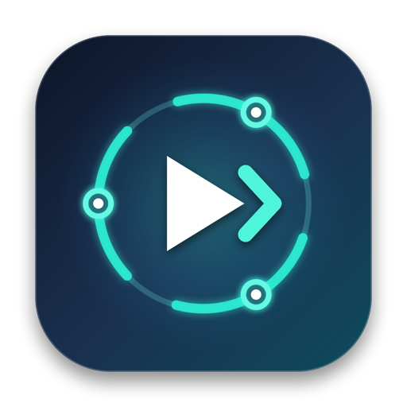

<p align="center">
  
</p>

<h1 align="center">Codex Continue</h1>

<p align="center">
  A lightweight native macOS Menu Bar utility that monitors your active OpenAI Codex desktop session, detects when all subagents have finished their work (<code>Active · 0</code>), and automatically sends <code>continue</code> so the parent agent only wakes up when needed.
</p>

---

## Why Codex Continue?

When running multi-agent workflows in the Codex desktop app, keeping the primary orchestrator agent running continuously burns through rate limits quickly while cheaper subagents are still working. **Codex Continue** watches the active Codex window with near-zero resource usage (`<0.1% CPU`, `~15 MB RAM`) using native macOS Accessibility (`AXUIElement`) and wakes the primary agent only after all active subagents complete.

## Key Features & Guardrails

1. **Customizable Target Chat Lock**
   - Lock onto any specific Codex chat tab (via the **Use Active Chat** button, the **Pick Chat** sidebar dropdown, or by typing a substring).
   - If you switch to a different chat tab in Codex, monitoring automatically pauses (`Paused (On: ...)`), ensuring it never types into the wrong conversation.

2. **Strict Edge-Triggered Subagent Monitor (`Active > 0` → `Active · 0`)**
   - Automatically arms when `Active · N` (`N > 0`) subagents are detected.
   - When subagents transition to `Active · 0` (`No active subagents`) and the primary agent is idle, waits for a configurable **Settle Delay** (default `5s`) before typing `continue` and clicking `Send`.

3. **User Activity Guard**
   - Checks `CGEventSource.secondsSinceLastEventType` for keyboard and mouse input. If you are actively using your Mac, it waits until your input has been idle for `3s` (configurable) before sending.

4. **Customizable Completion Stop Phrase**
   - Inspects the **latest primary agent response** (excluding user prompt bubbles and instructional quotes like `only says "..."`) for your configured completion phrase (default: `Decomp analysis is completed 100%`).
   - Automatically stops monitoring and sends a macOS notification once the task is 100% complete.

5. **Usage / Rate Limit Detection & Smart Auto-Resume**
   - Detects Codex usage-limit banners and inline transcript messages (`"You've hit your usage limit..."`, `"You're out of Codex and Work usage"`, `"Your rate limit resets on 12:28 PM..."`).
   - Supports two modes:
     - **Auto-resume after parsed reset time:** Parses the reset timestamp from the message, adds a configurable safety buffer (default `+2 min`), waits until the reset window arrives, and automatically sends `continue` to resume the session.
     - **Pause until manual resume:** Halts immediately and notifies you until you click **Resume Now**.

---

## Custom Menu Bar Status Icon Pack

Codex Continue includes a custom vector-drawn macOS Menu Bar icon pack (`Resources/MenuBarIcons/` and `CustomIconRenderer.swift`):

| Icon | Style ID | Meaning |
| :---: | :--- | :--- |
|  | `menubar-base` | Base Codex Continue orbital + forward chevron mark |
|  | `menubar-disabled` | Monitoring paused / disabled |
|  | `menubar-watching` | Watching chat (waiting for `Active > 0` subagents) |
|  | `menubar-active` | Armed & subagents actively running (`Active · N`) |
|  | `menubar-settling` | Settling countdown before send / post-send cooldown |
|  | `menubar-user-idle` | Waiting for user keyboard/mouse idle guard |
|  | `menubar-sending` | Injecting `continue` and clicking Send |
|  | `menubar-limit` | Paused on usage limit (counting down to reset time) |
|  | `menubar-completed` | Primary agent reported 100% completion |
|  | `menubar-alert` | Needs Accessibility permission or on a different chat |

---

## Build & Install to `/Applications`

Requirements: macOS 13.0+ and Xcode Command Line Tools (`swiftc`, `iconutil`).

```zsh
./build_app.sh --install
```

This builds the universal/release bundle, generates `AppIcon.icns` and the menu bar icon assets, installs **`CodexContinue.app`** directly into `/Applications/CodexContinue.app`, and clears any stale macOS TCC Accessibility hash so you can launch **Codex Continue** directly from **Spotlight (`Cmd+Space`)**, **Finder → Applications**, or enable **Launch at Login** inside the app's Guardrails tab.

### Running Automated Self-Tests

```zsh
./CodexContinue.app/Contents/MacOS/CodexContinue --self-test
```
